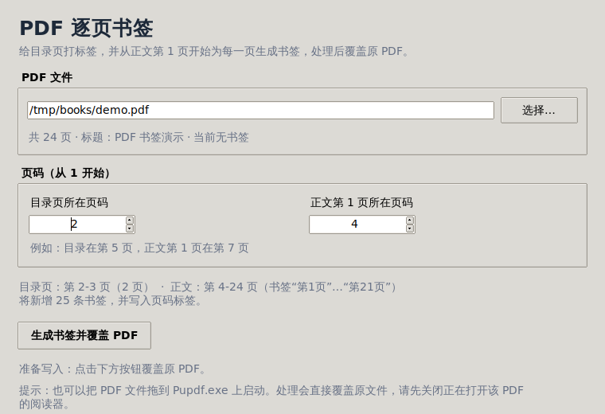

# Pupdf - PDF 逐页书签工具

给 PDF 批量创建“目录 + 正文页码”书签和页码标签，处理后**直接覆盖原 PDF**。
只要求输入两个页码：

1. 目录页所在页；
2. 正文第 1 页所在页。

命令行版本面向 Linux，图形界面版本面向 Windows。两者共用同一套经过测试的
PDF 处理核心，便于以后修改。

## 界面预览



> 截图为 Linux 测试环境（Xvfb）中的 Tk 界面，用于验证布局和交互；Windows 上
> 使用系统原生控件主题，视觉细节会略有不同。

## 功能

- 自动查找程序目录中的唯一 PDF（不递归、扩展名不区分大小写）。
- 根据两个页码自动推算：
  - 目录页范围：`目录页` 到 `正文第1页 - 1`；
  - 正文页范围：`正文第1页` 到最后一页，并从 1 开始编号。
- 写入 PDF 大纲书签：
  - `目录` → `目录 1`、`目录 2`……（只有一页目录时不生成冗余子项）；
  - `正文` → `第1页`、`第2页`……直到最后一页。
- 写入 PDF 页码标签：目录页显示“目录 1、目录 2…”，正文页显示“1、2…N”。
- 使用隐藏临时文件 + 重新打开校验 + 原子替换，失败时原 PDF 不受影响。
- 默认替换原有书签；可选保留原书签并追加。默认不生成 `.bak`，可按需开启。
- Linux CLI 支持参数和交互输入；Windows GUI 支持双击、拖文件到 exe、文件选择框。

### 书签示例

假设 PDF 共 100 页：

| 输入 | 值 |
| --- | --- |
| 目录页所在页码 | 5 |
| 正文第 1 页所在页码 | 7 |

生成结果：

```text
目录                 -> PDF 第 5 页
  目录 1             -> PDF 第 5 页
  目录 2             -> PDF 第 6 页
正文                 -> PDF 第 7 页
  第1页              -> PDF 第 7 页
  第2页              -> PDF 第 8 页
  ...
  第94页             -> PDF 第 100 页
```

同时写入页码标签：

- PDF 第 5-6 页显示 `目录 1`、`目录 2`；
- PDF 第 7-100 页显示 `1` 到 `94`。

> “目录页”和“正文第 1 页”都按 PDF 阅读器中显示的**物理页序号**填写，从 1 开始。
> 如果正文前有封面、前言等页面，它们保持原样，不会被纳入正文编号。

## 环境要求

- Python 3.10+。开发验证使用 Python 3.12；Windows 构建建议使用 64 位 Python 3.12。
- [PyMuPDF](https://pymupdf.readthedocs.io/)（安装时自动获取）。
- Linux CLI：不需要图形库。
- Linux GUI（可选）：`python3-tk` 和桌面环境。
- Windows GUI：官方 Python 自带 Tkinter；打包后不需要安装 Python。

## Linux 安装与使用

为了不污染系统 Python，推荐使用项目内的虚拟环境：

```bash
cd pupdf
python3 -m venv .venv
. .venv/bin/activate
python -m pip install --upgrade pip
python -m pip install -e .
```

### 交互模式（最常用）

把唯一一个 PDF 放在当前目录：

```bash
cd /path/to/book-folder
pupdf
```

程序会提示：

```text
目录页所在页码（1-99）：
正文第1页所在页码（6-100）：
```

请输入两个页码，确认后直接覆盖该 PDF。

### 非交互模式

```bash
# 自动查找当前目录的唯一 PDF
pupdf --toc-page 5 --body-page 7

# 指定 PDF
pupdf --pdf /data/books/demo.pdf --toc-page 5 --body-page 7

# 先预览，不修改文件
pupdf --toc-page 5 --body-page 7 --dry-run

# 保留原书签并追加；覆盖前生成 demo.pdf.bak
pupdf --toc-page 5 --body-page 7 --keep-outline --backup

# 只写书签，不写页码标签
pupdf --toc-page 5 --body-page 7 --no-page-labels
```

也可以使用模块方式运行：

```bash
python -m pupdf --toc-page 5 --body-page 7
```

### 命令行参数

```text
--pdf PATH            指定 PDF（默认自动查找唯一 PDF）
--dir DIR             自动查找 PDF 的目录（默认当前目录；也可配合 --gui）
--toc-page N          目录页所在页码
--body-page N         正文第 1 页所在页码
--keep-outline        保留并追加原书签（默认替换）
--no-page-labels      不写入页码标签
--backup              覆盖前创建 <原名>.pdf.bak
--dry-run             只显示计划，不修改
--gui                 启动图形界面
--debug               未预期错误时打印完整 traceback
--version             显示版本
```

退出码：`0` 成功；`1` PDF/文件错误；`2` 输入或参数错误；`130` 用户取消。

## Windows 可执行程序

Windows 版构建产物是一个无控制台的 GUI 程序 `Pupdf.exe`。由于 PyInstaller
不能从 Linux 直接交叉编译 Windows exe，请在 Windows 上构建，或使用仓库中的
GitHub Actions 工作流生成构建产物。

> 本仓库不附带预编译的 exe。当前仓库中的 Linux 源码、Tk 界面和 PyInstaller
> one-file 结构已实际验证；Windows 专用构建需要按下面步骤在 Windows 或 CI 上执行。

### 方式一：在 Windows 上构建

1. 安装 64 位 Python 3.10+（建议 3.12），安装时保留 Tcl/Tk 组件。
2. 解压源码，进入项目目录。
3. 双击运行：

```bat
scripts\build_windows.bat
```

脚本会在项目内创建隔离环境 `.venv-build`，安装依赖、运行测试，并用
PyInstaller 构建单文件 GUI 程序：

```text
dist\Pupdf.exe
```

也可以手动执行：

```bat
py -3 -m venv .venv-build
.venv-build\Scripts\activate
python -m pip install -e ".[dev]"
python -m pytest -q
python -m PyInstaller --noconfirm --clean pupdf.spec
```

### 方式二：GitHub Actions

推送代码后，在 Actions 页面运行 `windows-build` 工作流，下载
`Pupdf-windows` artifact，其中包含 `Pupdf.exe`。

### 使用方式

**双击打开**

1. 把 `Pupdf.exe` 和一个 PDF 放在同一个文件夹；
2. 双击 `Pupdf.exe`；
3. 程序自动显示该 PDF；
4. 输入目录页和正文第 1 页页码，点击“生成书签并覆盖 PDF”。

**把 PDF 拖到 exe 上**

1. 从资源管理器把任意位置的 PDF 拖到 `Pupdf.exe` 图标上；
2. 程序带该文件路径启动（不受 exe 所在目录限制）；
3. 输入两个页码并生成。

如果程序目录中有多个 PDF，程序不会猜测，界面会提示点击“选择…”指定文件。
Windows 版启动时会短暂解压运行时文件，这是 PyInstaller 单文件程序的正常现象。

## 行为与安全说明

- **覆盖目标**：始终覆盖打开的那个 PDF；不会另存新文件。可用 `--backup` 或
  复制原文件后操作。
- **原子写入**：先写同目录隐藏临时文件，重新打开并校验页数/书签数量，再用
  `os.replace` 替换原文件。任何一步报错都会删除临时文件，原文件保持不变。
- **文件锁**：Windows 阅读器打开 PDF 时可能锁定文件。覆盖失败时请关闭阅读器
  再重试。
- **加密 PDF**：带用户密码或权限密码的 PDF 会拒绝处理，避免在重写时丢失加密
  或权限设置。
- **数字签名**：任何 PDF 修改都会使已有数字签名失效。
- **原书签**：默认替换。若原书签需要保留，请使用 `--keep-outline`；GUI 在检测
  到已有书签时会二次确认。保留模式会保留标题、层级和页目标，但无法保留指向
  外部 URL 的书签（PDF 大纲的简单列表无法表达外部目标）。
- **页码标签**：使用标准 PDF `/PageLabels`，中文前缀以 UTF-16BE 写入，兼容
  主流阅读器；即使阅读器不显示页码标签，大纲书签仍然有效。
- **大文件**：处理需要重写整个 PDF，页数很多时需要一些时间；GUI 在后台线程
  执行，窗口不会假死。
- **自动查找**：只查一层目录，不递归；忽略本工具自己的 `.pupdf-*.pdf` 临时文件。

## 项目结构

```text
src/pupdf/
  core.py          PDF 分析、页码校验、书签/页码标签、原子覆盖（稳定 API）
  discovery.py     唯一 PDF 查找、拖放参数解析、GUI 启动选择
  cli.py           Linux 命令行界面和交互提示
  gui.py           Tkinter 延迟加载入口
  gui_app.py       Windows/Tk 图形界面
  errors.py        面向用户的异常类型
packaging/
  windows_launcher.py   Windows GUI exe 入口，负责无控制台错误提示
pupdf.spec         PyInstaller 单文件构建配置
scripts/
  build_windows.bat    一键 Windows 构建脚本
tests/            核心、CLI、文件查找、GUI 冒烟测试
docs/DEVELOPMENT.md   本次编码与调试过程记录
```

## 二次开发接口

核心逻辑与界面解耦，推荐直接调用 `pupdf.core`：

```python
from pupdf.core import analyze_pdf, build_plan, execute_plan, process_pdf

info = analyze_pdf("book.pdf")
print(info.total_pages, info.has_outline)

# 一步完成（会覆盖原文件）
result = process_pdf("book.pdf", toc_page=5, body_page=7, backup=True)
print(result.generated_bookmarks)

# 或者先规划、预览，再执行
plan = build_plan("book.pdf", toc_page=5, body_page=7, keep_outline=True)
print(plan.generated_outline)
print(plan.page_labels)
result = execute_plan(plan, backup=False)
```

主要数据类：

- `PageLayout`：已校验的 1-based 页码布局，提供 `toc_pages`、`body_pages`。
- `PdfInfo`：页数、标题、是否已有大纲。
- `ProcessPlan`：不可变的处理计划，包含 `final_outline` 和 `page_labels`。
- `ProcessResult`：实际写入结果，可用于 CLI/GUI 展示。

要调整书签层级或命名，修改 `ProcessPlan.generated_outline`；要调整页码标签，
修改 `ProcessPlan.page_labels`。两者都有单元测试覆盖。异常统一继承
`pupdf.errors.PupdfError`，界面层只负责转换成中文提示。

## 测试

```bash
. .venv/bin/activate
python -m pip install -e ".[dev]"
python -m pytest -q
```

测试覆盖：

- 书签分组、单页目录、书签页码、原书签替换/保留、幂等性；
- 页码标签、中文 UTF-16BE 前缀、关闭页码标签；
- 非法页码、加密 PDF、损坏 PDF、扩展名错误；
- 覆盖失败/写入失败时原文件不变、临时文件被清理；
- 自动查找唯一/多个 PDF、拖放参数解析、冻结 exe 的目录判断；
- CLI 参数、交互输入、dry-run、退出码；
- Tk GUI 冒烟测试（无显示环境时自动跳过）。

本次开发的实际测试输出和排错记录见
[docs/DEVELOPMENT.md](docs/DEVELOPMENT.md)。

## 常见问题

**提示“目录中有多个 PDF 文件”**

自动模式只处理唯一 PDF。只保留一个，或用 `--pdf` / GUI 的“选择…”指定。

**提示“正文第1页必须大于目录页”**

两个输入之间至少要有一页目录。请确认输入的是 PDF 物理页码，不是印刷页码。

**覆盖失败，提示文件被占用**

关闭 Adobe Acrobat、Edge、SumatraPDF 等正在打开该文件的程序，并检查文件是否
只读。失败不会损坏原文件；重新运行即可。

**Linux 上 `pupdf --gui` 提示缺少 Tkinter**

```bash
sudo apt install python3-tk
```

无桌面/无 X11 的服务器请直接使用 CLI。

**Windows 提示 SmartScreen/杀毒软件**

本地构建的 exe 没有代码签名，可能触发警告。可自行签名，或从源码运行
`python -m pupdf --gui`。

## 已知限制

- 不处理带密码的 PDF。
- 不解析目录页上的文字来确定章节，只根据用户给出的两个页码生成逐页书签。
- 重写 PDF 可能改变文件内部结构，不适合需要保留数字签名或严格 PDF/A 认证的文件。
- 自动查找只针对程序目录，不扫描子目录。

## License

MIT，见 [LICENSE](LICENSE)。
